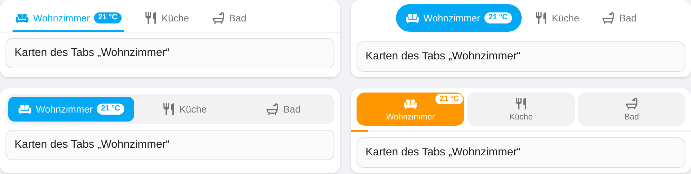

# Card Tabs für Home Assistant

[](https://hacs.xyz/docs/faq/custom_repositories)
[](https://github.com/Ga-Re/HACardTabs/actions/workflows/validate.yml)

Eine Lovelace-Karte mit **Tabs**. Jeder Tab ist eine eigene **Sektion**, in die du beliebige andere Karten legst.
Name, Icon und Farben jedes Tabs lassen sich anpassen. Tabs können **abhängig von Bedingungen** ein- oder ausgeblendet
werden, und die Karte kann **automatisch durch die Tabs wechseln**. Alles lässt sich im **visuellen Editor**
einstellen, YAML ist optional.



## Funktionen

- **Beliebig viele Tabs.** Jeder Tab ist eine Sektion mit eigenen Karten (1–6 Spalten).
- **Pro Tab einstellbar:** Name, Icon, Akzentfarbe, Text-/Iconfarbe, Hintergrund und ein Badge mit dem Zustand
  einer Entität (z. B. `21 °C`).
- **Bedingungen pro Tab:** Entitätszustand, numerischer Wert, Benutzer, Bildschirmgröße, Uhrzeit/Wochentag und
  Jinja-Templates, verknüpft mit UND oder ODER.
- **Automatischer Wechsel:** Intervall global oder pro Tab. Optional mit Fortschrittsbalken, Pause nach einer
  Interaktion, Pause bei Mouse-Over und Tabs, die übersprungen werden.
- **Zurück zum Standard-Tab** nach einer einstellbaren Zeit ohne Interaktion.
- **Tab-Leiste oben, unten, links oder rechts.** Stile: Unterstrichen, Pillen, Buttons oder Segmentiert.
  Ausrichtung, Icon über oder neben dem Namen, nur Icon oder nur Name.
- **Wischgesten** auf Touch-Geräten. Slider und Eingabefelder bleiben dabei bedienbar.
- **Letzten Tab merken** (pro Gerät), Animationen (Einblenden/Schieben), Tastatursteuerung (Pfeiltasten).
- **Visueller Editor** mit Karten-Auswahl und Karten-Editor von Home Assistant. Karten lassen sich hinzufügen,
  sortieren, kopieren und in einen anderen Tab verschieben. Die Vorschau springt zu dem Tab, den du gerade bearbeitest.
- Funktioniert in **Sections-, Masonry- und Panel-Ansichten**. Die `visibility`-Bedingungen der inneren Karten
  funktionieren weiterhin.
- Oberfläche auf Deutsch und Englisch.

## Installation

### HACS (empfohlen)

1. HACS öffnen → oben rechts **⋮** → **Benutzerdefinierte Repositories**.
2. Repository `https://github.com/Ga-Re/HACardTabs` mit dem Typ **Dashboard** hinzufügen.
3. **Card Tabs** suchen und herunterladen.
4. Den Browser neu laden (ggf. Cache leeren).

### Manuell

1. `dist/hacardtabs.js` herunterladen und nach `<config>/www/hacardtabs.js` kopieren.
2. **Einstellungen → Dashboards → ⋮ → Ressourcen** → Ressource hinzufügen:
   - URL: `/local/hacardtabs.js`
   - Typ: **JavaScript-Modul**
3. Den Browser neu laden.

## Verwendung

Dashboard bearbeiten → **Karte hinzufügen** → nach **Card Tabs** suchen. Der Editor hat drei Bereiche:

| Bereich         | Inhalt                                                                                                     |
| --------------- | ---------------------------------------------------------------------------------------------------------- |
| **Tabs**        | Tabs anlegen, sortieren, duplizieren und löschen. Pro Tab: _Allgemein_, _Karten_, _Bedingungen_ und _Stil_ |
| **Darstellung** | Position, Stil, Ausrichtung, Inhalt der Tab-Leiste, Animation, Abstände, Hintergründe, globale Farben      |
| **Verhalten**   | Standard-Tab, Tab merken, Wischgesten, Rückkehr zum Standard-Tab, automatischer Wechsel                    |

> Im Bearbeitungsmodus des Dashboards werden auch ausgeblendete Tabs angezeigt: ausgegraut, gestrichelt und mit
> durchgestrichenem Auge. Der automatische Wechsel ist dort pausiert.

## YAML-Referenz

### Karte

| Option                   | Typ     | Standard    | Beschreibung                                                              |
| ------------------------ | ------- | ----------- | ------------------------------------------------------------------------- |
| `type`                   | string  | –           | `custom:hacard-tabs`                                                      |
| `tabs`                   | list    | –           | Liste der Tabs (siehe unten)                                              |
| `default_tab`            | number  | `0`         | Index des Standard-Tabs (0 = erster Tab)                                  |
| `remember_tab`           | boolean | `false`     | Zuletzt gewählten Tab im Browser speichern                                |
| `storage_key`            | string  | automatisch | Eigener Schlüssel für `remember_tab` (z. B. für mehrere Dashboards)       |
| `tab_position`           | string  | `top`       | `top`, `bottom`, `left`, `right`                                          |
| `tab_style`              | string  | `underline` | `underline`, `pills`, `buttons`, `segmented`                              |
| `tab_alignment`          | string  | `start`     | `start`, `center`, `end`, `stretch`                                       |
| `tab_content`            | string  | `icon_name` | `icon_name`, `icon`, `name`                                               |
| `icon_position`          | string  | `start`     | `start` (neben dem Namen) oder `top` (über dem Namen)                     |
| `animation`              | string  | `fade`      | `none`, `fade`, `slide`                                                   |
| `card_gap`               | number  | `8`         | Abstand zwischen den Karten in px                                         |
| `card_background`        | boolean | `true`      | Hintergrund und Rahmen der Tab-Karte anzeigen                             |
| `inner_cards_background` | boolean | `true`      | `false` macht die Karten in den Tabs transparent (ohne Rahmen/Schatten)   |
| `hide_single_tab`        | boolean | `false`     | Tab-Leiste ausblenden, wenn nur ein Tab sichtbar ist                      |
| `swipe`                  | boolean | `true`      | Tabs per Wischgeste wechseln                                              |
| `return_to_default`      | number  | `0`         | Sekunden ohne Interaktion, bis zum Standard-Tab gewechselt wird (0 = aus) |
| `color`                  | string  | Primärfarbe | Globale Akzentfarbe des aktiven Tabs                                      |
| `text_color`             | string  | –           | Globale Text-/Iconfarbe                                                   |
| `active_text_color`      | string  | –           | Globale Text-/Iconfarbe des aktiven Tabs                                  |
| `background_color`       | string  | –           | Globale Hintergrundfarbe der Tabs                                         |
| `auto_cycle`             | object  | –           | Automatischer Wechsel (siehe unten)                                       |

### Tab

| Option              | Typ     | Beschreibung                                                                     |
| ------------------- | ------- | -------------------------------------------------------------------------------- |
| `name`              | string  | Name des Tabs                                                                    |
| `icon`              | string  | Icon, z. B. `mdi:sofa`                                                           |
| `cards`             | list    | Karten in diesem Tab (beliebige Lovelace-Karten)                                 |
| `columns`           | number  | Spalten in dieser Sektion (Standard `1`)                                         |
| `color`             | string  | Akzentfarbe (Unterstrich bzw. Hintergrund des aktiven Tabs)                      |
| `text_color`        | string  | Text-/Iconfarbe                                                                  |
| `active_text_color` | string  | Text-/Iconfarbe, wenn aktiv                                                      |
| `background_color`  | string  | Hintergrundfarbe des Tabs                                                        |
| `badge_entity`      | string  | Entität, deren Zustand als Badge am Tab angezeigt wird                           |
| `conditions`        | list    | Bedingungen, wann der Tab sichtbar ist                                           |
| `condition_mode`    | string  | `all` (UND, Standard) oder `any` (ODER)                                          |
| `cycle_duration`    | number  | Anzeigedauer beim automatischen Wechsel in Sekunden (überschreibt das Intervall) |
| `skip_cycle`        | boolean | Tab beim automatischen Wechsel überspringen                                      |

**Farben** können als Hex-Wert (`#ff9800`), beliebige CSS-Farbe (`rgb(…)`, `var(--my-color)`) oder als
Home-Assistant-Farbname angegeben werden: `primary`, `accent`, `red`, `pink`, `purple`, `deep-purple`, `indigo`,
`blue`, `light-blue`, `cyan`, `teal`, `green`, `light-green`, `lime`, `yellow`, `amber`, `orange`, `deep-orange`,
`brown`, `grey`, `blue-grey`, `black`, `white`.

### Bedingungen

```yaml
conditions:
  # Entitätszustand (state oder state_not; auch Listen möglich; optional attribute)
  - condition: state
    entity: light.wohnzimmer
    state: "on"
  # Numerischer Wert (above/below dürfen auch Entitäten sein)
  - condition: numeric_state
    entity: sensor.temperatur
    above: 20
    below: 30
  # Benutzer (IDs aus Einstellungen → Personen → Benutzer)
  - condition: user
    users:
      - 0123456789abcdef
  # Bildschirmgröße (Media Query)
  - condition: screen
    media_query: "(min-width: 1024px)"
  # Uhrzeit / Wochentage (lokale Zeit des Geräts; über Mitternacht möglich, z. B. 22:00–06:00)
  - condition: time
    after: "08:00"
    before: "20:00"
    weekdays: [mon, tue, wed, thu, fri]
  # Jinja-Template (wird live vom Server ausgewertet)
  - condition: template
    value_template: "{{ is_state('person.anna', 'home') }}"
```

Im YAML-Code kannst du die Bedingungen außerdem mit `and`, `or` und `not` verschachteln:

```yaml
conditions:
  - condition: or
    conditions:
      - condition: state
        entity: input_boolean.party
        state: "on"
      - condition: user
        users: [0123456789abcdef]
```

### Automatischer Wechsel

```yaml
auto_cycle:
  enabled: true
  interval: 10 # Sekunden pro Tab
  pause_on_interaction: 30 # nach Klick/Touch so lange pausieren (0 = nicht pausieren)
  pause_on_hover: true # pausieren, solange die Maus über der Karte ist
  show_progress: true # Fortschrittsbalken anzeigen
```

Gewechselt wird nur zwischen sichtbaren Tabs. Tabs mit `skip_cycle: true` werden übersprungen, `cycle_duration`
überschreibt das Intervall für einen einzelnen Tab.

## Beispiel

```yaml
type: custom:hacard-tabs
tab_style: pills
tab_alignment: center
remember_tab: true
auto_cycle:
  enabled: true
  interval: 15
tabs:
  - name: Wohnzimmer
    icon: mdi:sofa
    color: orange
    badge_entity: sensor.wohnzimmer_temperatur
    cards:
      - type: tile
        entity: light.wohnzimmer
      - type: thermostat
        entity: climate.wohnzimmer
  - name: Energie
    icon: mdi:lightning-bolt
    color: "#4caf50"
    columns: 2
    cycle_duration: 30
    cards:
      - type: entity
        entity: sensor.pv_leistung
      - type: entity
        entity: sensor.netzbezug
  - name: Waschmaschine
    icon: mdi:washing-machine
    color: blue
    conditions:
      - condition: state
        entity: sensor.waschmaschine_status
        state_not: ["off", "unavailable"]
    cards:
      - type: entities
        entities:
          - sensor.waschmaschine_restzeit
  - name: Nacht
    icon: mdi:weather-night
    color: indigo
    skip_cycle: true
    conditions:
      - condition: time
        after: "22:00"
        before: "06:00"
    cards:
      - type: markdown
        content: Gute Nacht!
```

## Feintuning per CSS / card-mod

| Variable                  | Beschreibung                       |
| ------------------------- | ---------------------------------- |
| `--hacard-tabs-font-size` | Schriftgröße der Tabs              |
| `--hacard-tabs-icon-size` | Icongröße der Tabs (Standard 20px) |
| `--hacard-tabs-padding`   | Innenabstand des Tab-Inhalts       |

## Entwicklung

```bash
npm install
npm run build   # erzeugt dist/hacardtabs.js
npm run dev     # baut bei Änderungen neu und startet http://localhost:5055/dev/
```

`dev/index.html` ist eine Testseite mit einem simulierten Home Assistant (Platzhalter für `ha-form`, die
Karten-Editoren usw.), damit du Karte und Editor ohne laufende Home-Assistant-Instanz ausprobieren kannst.

Für einen neuen Release `version` in `package.json` und `VERSION` in `src/const.js` erhöhen, dann einen Tag pushen
(`git tag v1.1.0 && git push origin v1.1.0`). Der Workflow `release.yml` baut die Karte und veröffentlicht den
Release mit `hacardtabs.js` als Anhang.

---

## English

**Card Tabs** is a Lovelace card with configurable tabs. Every tab is a section that holds any other cards. For each
tab you can set the name, icon and colors, a badge and visibility conditions (state, numeric state, user, screen,
time/weekday, template). The card can switch tabs automatically, with an optional progress bar and a pause on
interaction or hover. Everything can be configured in the visual editor, and the UI is available in English and German.
Install it via HACS as a custom repository (type **Dashboard**) and add the card **Card Tabs**
(`type: custom:hacard-tabs`). See the YAML reference above for all options.

## Lizenz

MIT
